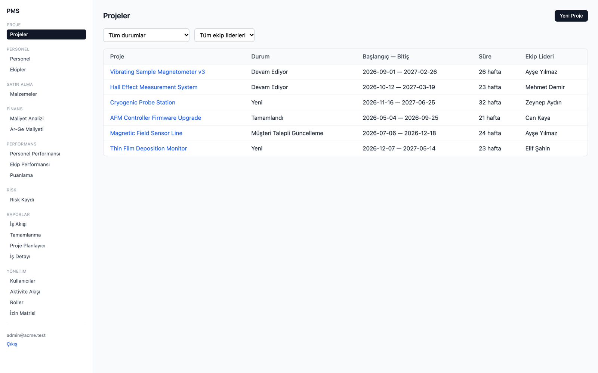
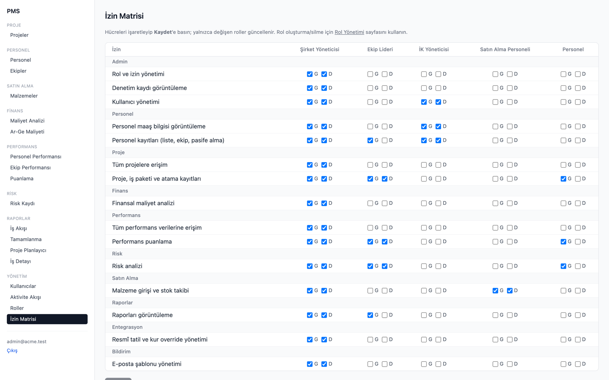
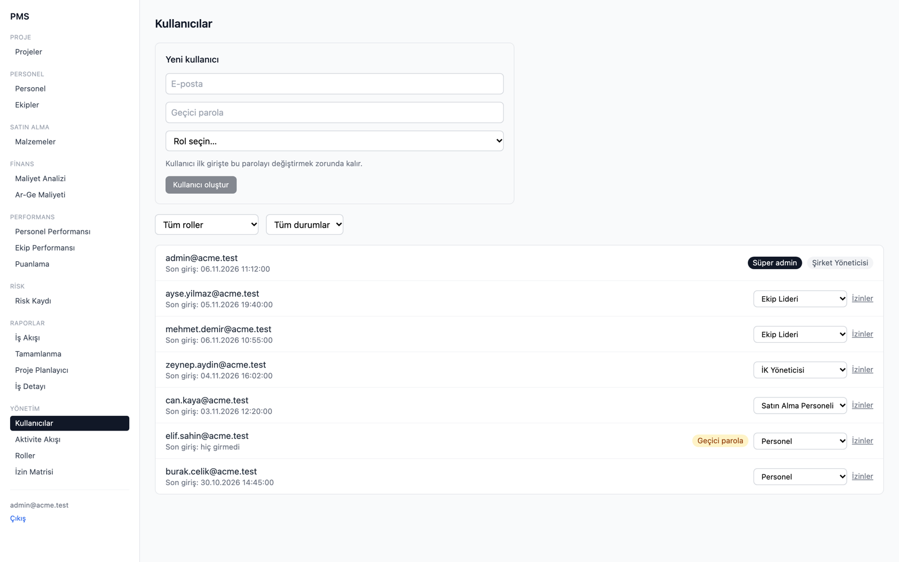

# PMS Platform — Project Management System for R&D-driven manufacturers

A modular, microservice-ready project management system built as a TypeScript monorepo: project and work-package planning,
personnel, procurement and stock, R&D cost tracking, performance scoring, a risk register, notifications and reporting.
It has a React frontend, a Supabase (PostgreSQL) database with row-level security, and event-driven communication between services.

> **Status:** in active development, as a personal product prototype. Authentication, personnel, procurement, projects and the
> admin console are wired end-to-end through the API gateway. Event-driven completion flows are still in progress.
> Code comments and domain names are mostly in Turkish because the target market is Turkey. The UI supports Turkish and English (i18n).

## Screenshots

The React frontend, rendered with sample data (UI language: Turkish).

**Projects:** list with status and team-lead filters


**Permission matrix:** per-role view/edit grants, enforced by the API gateway and by Postgres RLS


**User management:** role assignment, temporary passwords with forced change, per-user permission overrides


## Tech stack

| Layer | Technologies |
|---|---|
| Frontend | React 18, Vite, TypeScript, TanStack Query, React Router, react-hook-form + zod, Tailwind CSS, i18next |
| Backend | Node.js, TypeScript, Fastify (API gateway + 11 services), clean architecture (api / core use-cases / infrastructure) |
| Data | Supabase (PostgreSQL), numbered SQL migrations, row-level security policies, permission-based RBAC (`has_permission()`) |
| Messaging & cache | RabbitMQ (domain events, audit log pipeline), Redis (caching, cache invalidation via events) |
| Quality | Vitest (~390 unit tests + cross-service integration suites), Testing Library, Playwright E2E, autocannon load tests, ESLint |
| DevOps | Docker / Docker Compose, GitHub Actions CI (lint, test, build per workspace; RLS tests; `npm audit` gate; real-RabbitMQ event tests) |

## Architecture

```
web (React + Vite)
   │  REST / JWT
api-gateway :3000  ── auth, routing, rate limiting
   │
   ├── identity-service      :3001  users, roles, permission matrix, per-user overrides, forced password change
   ├── personnel-service     :3002  employees, teams, salary visibility (permission-gated)
   ├── project-service       :3003  projects, work packages, assignments, planning wizard
   ├── procurement-service   :3004  materials, stock
   ├── integration-service   :3005  external data (e.g. exchange rates)
   ├── finance-service       :3006  R&D cost analysis
   ├── performance-service   :3007  employee / team scoring
   ├── risk-service          :3008  risk register
   ├── notification-service  :3009  e-mail notifications (SMTP adapter)
   ├── reporting-service     :3010  completion status, Gantt, workflow reports
   └── logger-service        :3011  audit events, activity feed
            │
   Supabase Postgres (RLS)  ·  RabbitMQ (events)  ·  Redis (cache)
```

**Ground rule:** a service never touches another service's tables directly. Services talk only via REST (sync) or
RabbitMQ events + Redis (async / cache). Shared DTOs, event contracts and error types live in `shared/`.

### Architecture decision: microservice-ready, not microservices on day one

Each service is deployed on its own and owns its own tables, but all services share one Supabase (PostgreSQL) database for now.

- **Why not full microservices yet:** a database per service brings distributed transactions, cross-service data
  consistency and extra infrastructure to operate. At this stage that cost buys nothing.
- **Why not a single monolith:** clear service boundaries, table ownership and event-driven communication keep the
  modules independent, so work on one area never blocks another and the codebase stays easy to extend.
- **How it scales:** when one area needs to scale on its own, its tables move to a dedicated database and the service is
  split out. Nothing else changes, because no other service reads those tables directly.

## Repository layout

```
api-gateway/          single entry point
services/*            11 independent services, each with its own Dockerfile and .env.example
web/                  React frontend (features/: admin, auth, personnel, procurement, projects, finance, performance, risk, reporting)
shared/               DTOs, event definitions, error catalogue, RabbitMQ/Redis clients
migrations/supabase/  numbered SQL migrations, incl. 012_rls_policies.sql
tests/                cross-service tests: rls/, events/ (real RabbitMQ), cache/ (RabbitMQ + Redis), integration/
e2e/                  Playwright tests
loadtest/             autocannon scenarios
docs/                 security audit baseline, RBAC matrix, RLS / load / event-integration test plans
```

## Getting started

```bash
npm install                          # installs all workspaces
cp services/identity-service/.env.example services/identity-service/.env   # repeat per service, fill in Supabase keys
npm run dev:infra                    # RabbitMQ + Redis via Docker Compose
npm run build --workspace=shared
npm run dev --workspace=services/identity-service
npm run dev --workspace=web
```

## Tests

```bash
npm test               # unit tests across all workspaces
npm run test:rls       # row-level security scenarios (skipped without Supabase secrets)
npm run test:events    # publisher → consumer tests against a real RabbitMQ
npm run test:cache     # event-driven cache invalidation against RabbitMQ + Redis
npm run test:e2e       # Playwright
npm run test:load      # load-test harness
npm run security:audit # fails on moderate+ vulnerabilities
```

## Author

Muhammed Okmen · [github.com/okmen1306](https://github.com/okmen1306)
